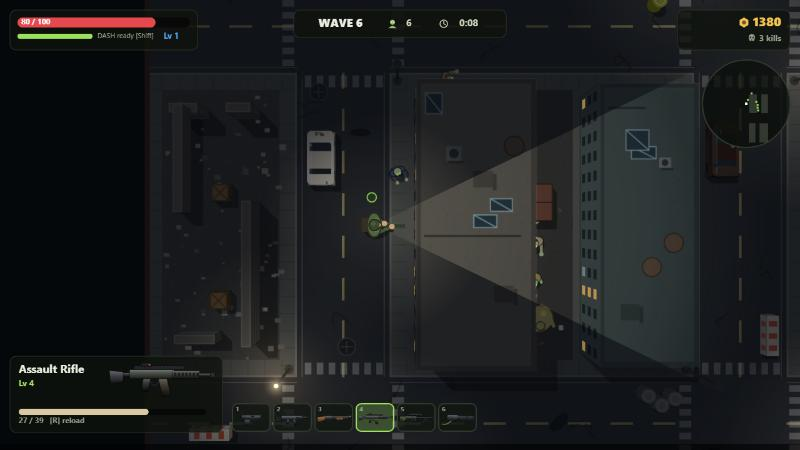
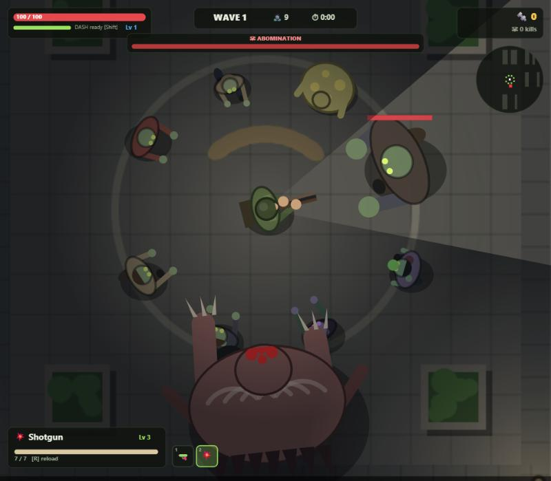
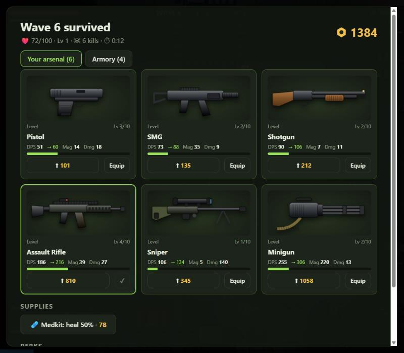
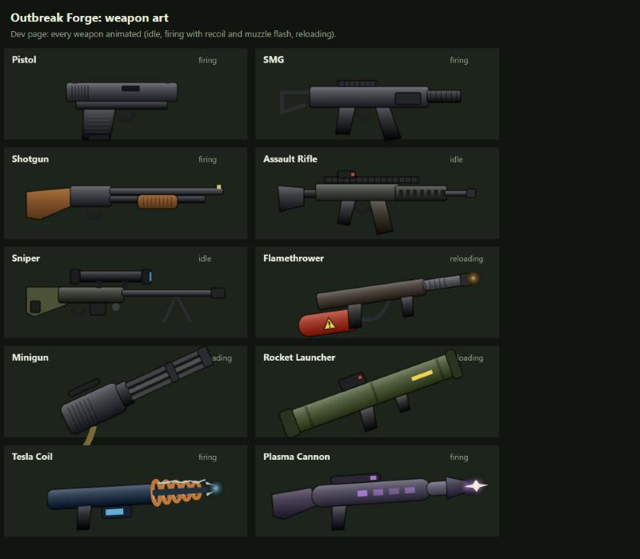

# 🧟 Outbreak Forge

> A top-down zombie survival game that runs in the browser. Survive endless waves in a **ruined city at night**, collect scrap, **forge deadlier weapons**, mutate with perks on every level-up and **evolve permanently** in the Laboratory between runs.

<p align="center">
  
  
</p>
<p align="center">
  
  
</p>

### ▶ [Play it in your browser](https://alexgoga213.github.io/outbreak-forge/)


---

## 🎮 Gameplay loop

```
   ┌──────────── wave of zombies ─────────────┐
   │  shoot · dash · kite · collect scrap/XP  │
   └───────┬──────────────────────┬───────────┘
           │ level up             │ wave cleared
           ▼                      ▼
   choose 1 of 3 perks      SHOP: buy & upgrade weapons, medkits
           │                      │
           └──────► next wave ◄───┘        every 5th wave: ☠️ BOSS
                       │
                   you die
                       ▼
        earn DNA → LABORATORY: permanent upgrades → next run is stronger
```

## ✨ Features

- **10 weapons**, each upgradeable to level 10: Pistol, SMG, Shotgun, Assault Rifle, Sniper, Flamethrower, Minigun, Rocket Launcher, Tesla Coil (chain lightning), Plasma Cannon
- **4 weapon mechanics:** travelling bullets with pierce, explosive rockets, flame cones that set zombies on fire, instant chain lightning
- **7 zombie types** with their own behaviour:

  | Zombie | Behaviour |
  |---|---|
  | Walker | Slow, comes in hordes |
  | Runner | Fast and fragile |
  | Bloater | Explodes on contact and hurts everything nearby |
  | Brute | Huge HP pool, hits hard |
  | Spitter | Keeps its distance and spits acid |
  | Stalker | Lunges at you in sudden dashes |
  | ☠️ Abomination | Boss every 5 waves: charges and summons walkers |

- **18 perks** in 4 rarities, offered on every level-up: Orbiting Blades, Combat Drones, Split Shot, Frost Rounds, Explosive Rounds, Bloodlust, Kevlar…
- **Meta progression:** DNA earned each run buys 8 permanent Lab upgrades (HP, damage, scrap, XP, starting weapon, rarer perks…), saved in `localStorage`
- **Procedural city, new every run:** road grid with crosswalks, buildings with rooftop details and shadows, alleys with dumpsters, parking lots, parks with trees you can walk under, ruined blocks, wrecked and **burning cars**, barrels and concrete barriers
- **Real obstacles:** buildings and wrecks block movement and bullets; rockets explode on walls
- **Smart hordes:** zombies route around the city with a **flow-field pathfinder**, then charge straight at you once they have line of sight
- **Night lighting:** your flashlight follows the mouse; street lamps flicker, fires, muzzle flashes, explosions and burning zombies light up the dark
- **Hand-drawn-in-code characters:** animated walk cycles, a soldier with a different gun model for every weapon, zombies in random torn clothes, swollen Bloaters, hulking Brutes and a four-armed boss
- **Game feel:** screen shake, hit flashes, damage numbers and crits, persistent blood and scorch decals, shell casings, muzzle flashes, a radar with the city map, a boss health bar
- **2.5D "top-down but 3D" look:** buildings, wrecked cars, dumpsters, walls, barrels, lamp posts and trees are real 3D volumes projected from a virtual camera above the player. Walls lean away from the camera, lit windows glow at night, characters' heads lean with the perspective, and debris, blood and shell casings fly up and bounce on the ground.
- **Detailed weapon art drawn in code** (no images): every gun has its own side-view model in the HUD and the shop, with recoil kick, muzzle flash, reload animation, a spinning minigun, a flickering pilot flame and glowing energy weapons
- **Procedural audio, no sound files:**
  - a different gunshot recipe per weapon (sharp pistol crack, shotgun boom and pump, sniper shot with echo and bolt action, minigun motor whine, flamethrower roar, rocket whoosh, tesla zap, plasma "pew")
  - reload foley timed to each reload: magazine out and in, slide, shells, power-up whine
  - zombie voices with formant filters: each type groans, snarls when attacking and dies differently; the boss roars and stomps, the Stalker shrieks, the Spitter spits
  - impacts and ricochets, explosions with debris, a wave siren, a wave-clear jingle, UI clicks, and night ambience (wind, low drone, distant sirens)
  - stereo panning and distance attenuation from the player, plus a reverb that makes far sounds wetter
- **Zero dependencies, no build step:** plain ES modules, so it runs straight from GitHub Pages

## 🕹️ Controls

| Key | Action |
|---|---|
| `W A S D` / arrows | Move |
| Mouse | Aim · **hold left click** to shoot |
| `Shift` / `Space` | Dash (short invulnerability) |
| `1`–`0` / mouse wheel | Switch weapon |
| `R` | Reload |
| `Esc` / `P` | Pause |
| `1` `2` `3` | Pick a perk on level-up |
| `Enter` | Next wave (in the shop) |

## 🛠️ How it's built

```
outbreak-forge/
├── index.html / styles.css
├── src/
│   ├── main.js      # game loop (requestAnimationFrame, clamped dt, HiDPI canvas)
│   ├── game.js      # simulation + rendering: player, weapons, zombies, AI, effects, HUD
│   ├── city.js      # procedural city generator + obstacle collision and line of sight
│   ├── pathfinding.js # flow field (one BFS from the player guides every zombie)
│   ├── characters.js  # procedural humanoid player and zombie drawings with walk cycles
│   ├── lighting.js  # night darkness layer, flashlight cone, lamps and fire lights
│   ├── weaponArt.js # side-view weapon drawings with recoil/reload animation + HUD icons
│   ├── weapons.js   # weapon catalogue, level scaling, DPS
│   ├── zombies.js   # zombie archetypes, wave size and HP scaling
│   ├── perks.js     # level-up perks, Lab upgrades, XP curve
│   ├── ui.js        # DOM screens: menu, shop, level-up, lab, game over
│   ├── audio.js     # procedural Web Audio: per-weapon shots, zombie voices, ambience, spatial mix
│   ├── input.js     # keyboard / mouse state
│   ├── save.js      # localStorage persistence (fails safely)
│   └── util.js      # math helpers + spatial hash grid
├── tools/autoplay.js        # headless bot used to play-test and balance the game
└── tools/weapon-gallery.html # dev page showing every weapon animation
```

Some technical details:

- **Spatial hash grid:** every frame, zombies are bucketed into 96 px cells. Bullet hits, explosions, chain lightning and crowd separation then only look at nearby cells instead of checking every pair, so hundreds of zombies stay smooth.
- **Flow-field pathfinding:** the city is rasterised into 30 px cells, and a breadth-first search from the player's cell runs 4× per second. Every zombie reads the downhill direction from its own cell, so the cost does not depend on horde size. A second field with more clearance is used for the big zombies, so they never try alleys they cannot fit through.
- **Static city layer:** the whole city is painted once into a world-sized offscreen canvas. Each frame only copies the visible rectangle, and the same happens for the blood-decal layer.
- **2.5D projection:** a point at height *h* is drawn at `p + (p - camera) * h / (CAM_H - h)`. Each box draws only the walls that face the camera, then its roof as the footprint scaled around the camera point. Objects are sorted far-to-near each frame, so near buildings correctly hide what is behind them.
- **Lighting:** a screen-sized darkness layer is cut open with `destination-out` radial gradients and cones, then warm additive glows are added on top.
- **Data-driven design:** weapons, zombies, perks and Lab upgrades are plain data tables. Player stats are recomputed from *base → Lab → perks*, so a new perk is one line of code.
- **Crowd AI:** steering towards the player plus soft separation, so hordes spread out instead of stacking. Spitters keep their range, Stalkers lunge, and the boss charges and summons.
- **Balancing with a bot:** `tools/autoplay.js` runs the simulation headlessly at 60 steps/s. It aims, kites, shops and picks perks, which made it possible to tune wave scaling and the economy over many simulated runs and to catch runtime errors.
- **Robust persistence:** every `localStorage` access is wrapped in try/catch, so private windows or blocked storage just mean progress isn't saved.

## ▶️ Run locally

Any static file server works, for example:

```bash
python -m http.server 8000
```

Then open <http://localhost:8000>. ES modules need to be served over HTTP; opening `index.html` directly from disk will not work.

## 🔮 Ideas

- [ ] Touch controls (twin-stick) for phones
- [ ] Enterable buildings with loot
- [ ] Weapon mods (e.g. incendiary sniper, cluster rockets)
- [ ] Online leaderboard

---

<sub>Made by Goga Alex-Andrei · MIT License</sub>
